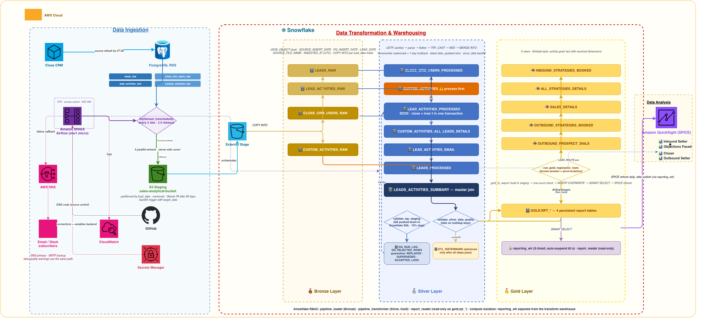
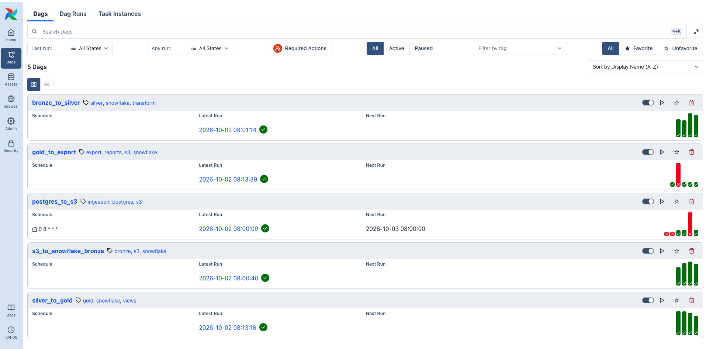
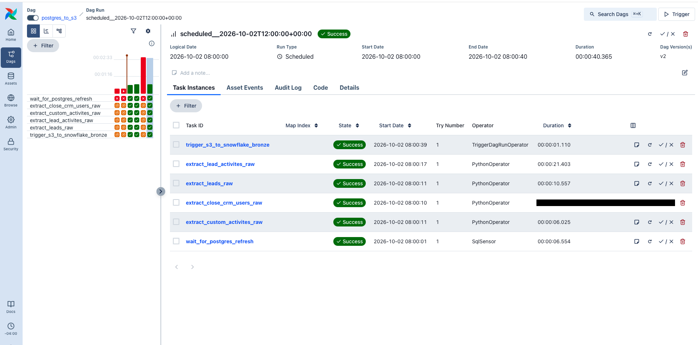
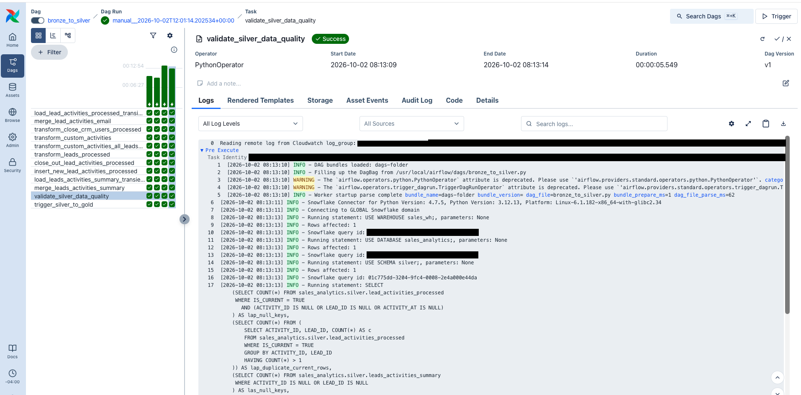
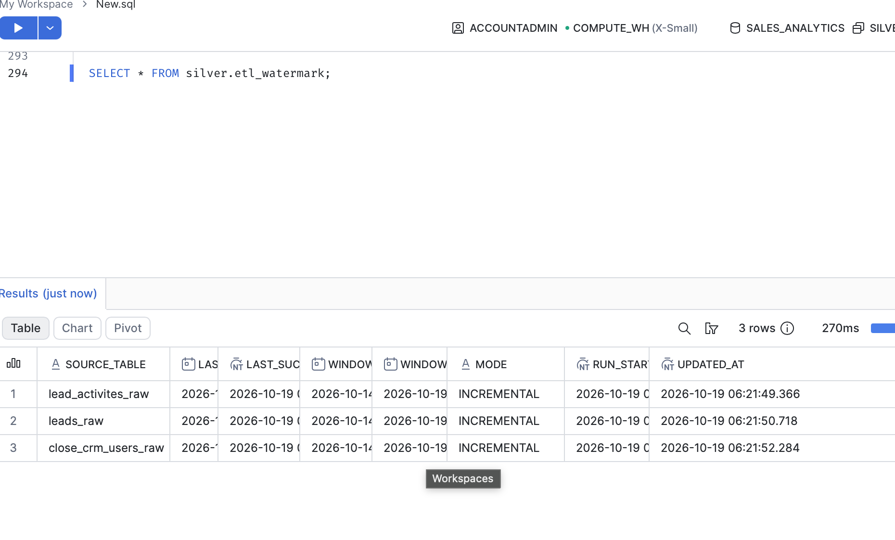
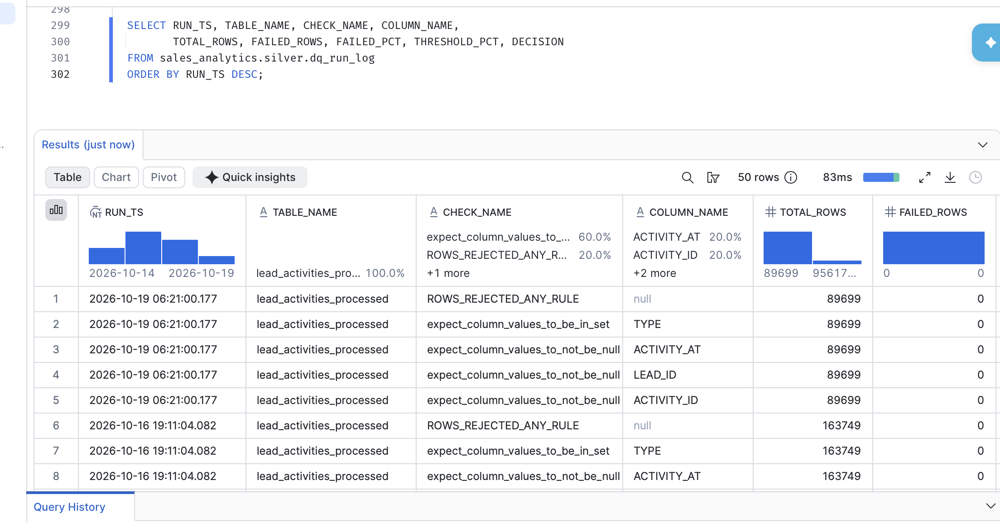
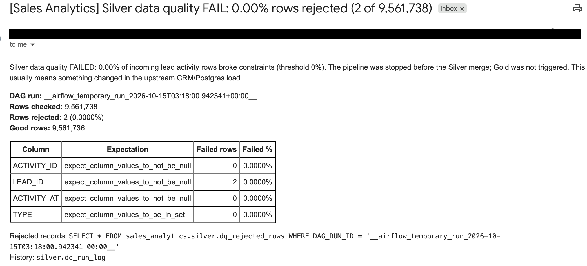
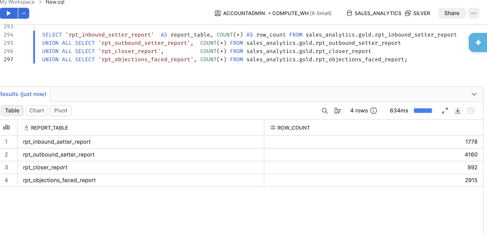
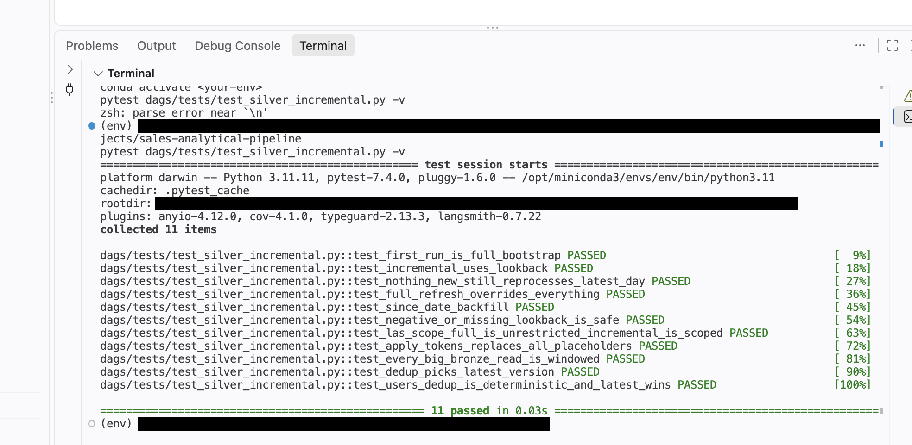
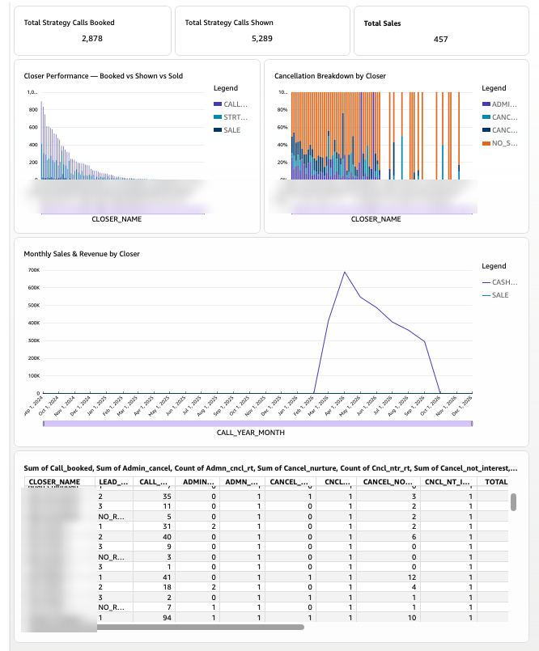

# Sales Analytics Pipeline

An idempotent, incremental ELT pipeline that turns a sales team's messy CRM data into governed KPI reports. It takes nested, malformed JSON from a Close CRM feed in PostgreSQL, lands it in S3 and Snowflake, cleans it through a Bronze / Silver / Gold medallion design, and serves four reports (Inbound Setter, Outbound Setter, Closer, Objections Faced) to QuickSight. Orchestrated with Apache Airflow on Amazon MWAA (managed Airflow).



## The problem

- CRM activity arrives as deeply nested, single-quote-escaped JSON. Outcomes are stored as opaque internal IDs, not names.
- Every daily extract restates the full history, so naive appends multiply every count by the number of days loaded.
- Analysts cleaned the data by hand before every report, and leadership had almost no visibility into setter and closer performance, conversion or why deals were lost.

About 2 million unique activities (about 2.2 million rows including history); roughly 1,300 activity IDs belong to more than one lead, so the obvious key (`ACTIVITY_ID`) is not unique.

## What it does

```
Close CRM -> PostgreSQL (raw.*) -> S3 (load_date=YYYY-MM-DD) -> Snowflake Bronze
          -> Silver (clean, conform, validate) -> Gold (funnel views) -> gold.rpt_* tables -> QuickSight
```

Five decoupled DAGs, each triggering the next and each re-runnable on its own:

| DAG | Job |
|---|---|
| `postgres_to_s3` | Daily incremental extract by `INSERT_DATE` (08:00 schedule), streamed to S3 as multipart upload. Backfill any day with `{"target_date": "YYYY-MM-DD"}`. |
| `s3_to_snowflake_bronze` | `COPY INTO` Bronze exactly as received, scoped to one dated folder. |
| `bronze_to_silver` | JSON repair, flatten, ID-to-name resolution, Great Expectations gate, MD5-hash MERGE, SCD2 on the activity log. Incremental (see below). |
| `silver_to_gold` | Rebuilds the five business views that define the funnel (booked, taken, offer, sale) once, for every report. |
| `gold_to_export` | Builds four persistent `gold.rpt_*` report tables with a row-count gate and an atomic publish. |

## Design decisions

- **ELT, raw first.** Bronze keeps the payload untouched, so an upstream schema change cannot break loading and any day can be replayed.
- **MD5-hash MERGE.** Each Silver table hashes its significant columns; MERGE inserts new rows and updates only changed ones, so every run is idempotent and `UPDATE_DATE` means a real change.
- **Composite key** `ACTIVITY_ID + LEAD_ID` everywhere (table, MERGE, joins, Gold pivots).
- **SCD Type 2 only where it earns its place:** `LEAD_ACTIVITIES_PROCESSED` keeps history (close-out, then insert), so a number that moved can be traced to a CRM change, not a rerun. Other Silver tables are Type 1.
- **Quality gate before the write.** A Great Expectations suite validates each load, quarantines bad rows with the reason, logs pass/reject counts, warns by email, and stops the run if 10% or more fail.
- **Gold is the single source of truth.** Reports read persistent `gold.rpt_*` tables, published with `INSERT OVERWRITE` so grants survive and a failed build never replaces good data.
- **Serving isolation.** Dashboards use a dedicated X-Small, auto-suspend warehouse (`reporting_wh`) under a read-only role (`report_reader`), separate from the warehouse that loads and transforms.
- **Governance.** Least-privilege IAM; three Snowflake roles (loader, transformer, reader); column lineage from the raw JSON key to the report column ([docs](docs/Column%20Lineage%20-%20Sales%20Analytics.md)); Airflow run history and Snowflake access history for audit.

### Incremental Silver

Silver used to re-read all of Bronze on every run. It now reads only the batches since the last successful run:

- A control table, `silver.etl_watermark`, holds one row per Bronze source. The last task advances it only after every Silver step and the quality check pass, so a failed run is simply re-read.
- Modes: incremental (last committed date minus a one-day lookback), `since_date` backfill, and `full_refresh`. One active run at a time.
- The newest version of a record wins: latest `date_updated`, then newest batch, then event time, with a deterministic final tie-break.
- Validated against a full rebuild: a zero-copy clone of Silver, a full refresh, then EXCEPT comparisons in both directions on key and hash. All five tables match. The comparison first failed twice, and both were real bugs in version selection.

In my runs, a full refresh took about 12 minutes and an incremental run over two weeks of data about 2 minutes (single runs, not a benchmark).

## Testing

| Test file | What it checks | Needs Snowflake |
|---|---|---|
| `dags/tests/test_silver_incremental.py` | Window logic, every Bronze read is windowed, dedup rule | No |
| `dags/tests/test_silver_incremental_parity.py` | Incremental result equals a full rebuild | Yes, plus `SILVER_PARITY_BASELINE` |
| `dags/tests/test_gold_pivot_isolation.py` | No pivot can mix two leads that share an activity ID (source check and live check) | Live part only |
| `dags/tests/test_gold_regression.py` | Known-answer regression suite for the Gold layer, run as a gate in `gold_to_export` | Yes |

```bash
pytest dags/tests/test_silver_incremental.py -v      # no credentials needed
pytest dags/tests -v                                  # live tests skip without credentials
```

## Screenshots

Account IDs, ARNs, network IDs and personal names are redacted or blurred.

**Orchestration (Amazon MWAA)**

| | |
|---|---|
|  |  |
| Five chained DAGs | Ingestion run with sensor and parallel extracts |



**Snowflake layers and data quality**






**Tests**



**QuickSight reports (names blurred)**



## Repository layout

```
dags/            Airflow DAGs (five pipeline stages) and silver_incremental.py helpers
dags/tests/      Unit, parity and regression tests
snowflake/       Reference SQL for the Silver tables, Gold views and reports, plus roles and warehouse setup
docs/            Column lineage, interview reading list, project story, runbooks
mwaa/            requirements for the MWAA deployment
```

## Running it

Requires Python 3.11, Apache Airflow 3.x, a Snowflake account, a PostgreSQL source and an S3 bucket.

1. Create the Snowflake objects from `snowflake/` (roles, warehouses, databases, UDFs, tables, then `reporting_setup.sql`).
2. Install the Airflow providers for Snowflake, Postgres and Amazon, plus Great Expectations. Pin SQLAlchemy to 2.0.x; 2.1 breaks the Snowflake dialect.
3. Create Airflow connections: `postgres_close_crm`, `aws_default`, `snowflake_default`, `smtp_default` (alerts).
4. Put the DAGs in your Airflow `dags/` folder and unpause them. `postgres_to_s3` runs on its schedule and triggers the rest.
5. Credentials belong in Airflow connections or environment variables, never in the repository.

First `bronze_to_silver` run bootstraps the watermark with a full pass; later runs are incremental. Rebuild from scratch with `{"full_refresh": true}`; reprocess a date range with `{"since_date": "2026-10-01"}`.

## Status

Orchestrated on Amazon MWAA (managed Airflow) against Snowflake.

## Stack

Apache Airflow (Amazon MWAA), Snowflake (SQL, Python UDFs), PostgreSQL, Amazon S3, AWS IAM, Great Expectations, QuickSight, pytest.
